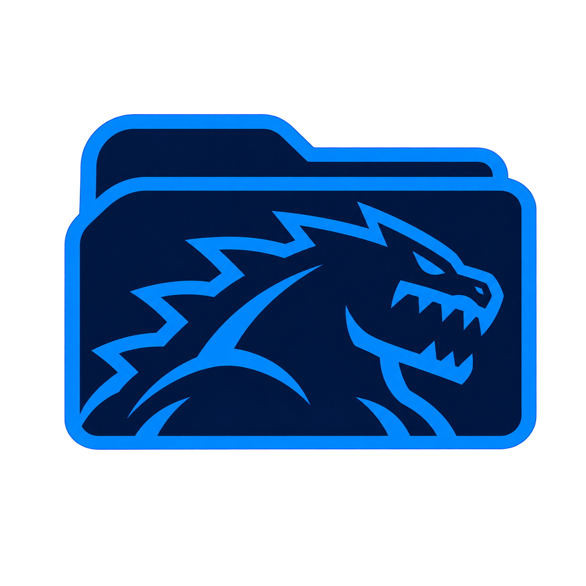

<p align="center"></p>

# omakaiju


A modern, ultra-lightweight, dual-pane TUI file manager for Unix-like systems. Built in Go with Bubble Tea + Lipgloss.

---

## Why omakaiju?

* **Blazing Fast & Ultra-Lightweight:** Launches in ~35ms with a footprint of ~19MB RAM as a single static binary with no daemons or runtime dependencies.
* **Dead Simple Keybindings:** Navigate with arrow keys, and press `Shift+K` for everything else. Keybindings are clean, sectioned, and fully filterable on the fly.
* **Non-Blocking Asynchronous I/O:** Syntax highlighting, previews, fuzzy matching, and directory walks run strictly in the background—the UI never lags or freezes.
* **Resilient & Crash-Proof:** Features built-in error recovery. Internal render or update panics are caught and reported in the status bar while your session stays active.
* **Seamless Omarchy Integration:** Dynamic theme integration with instant hot-reloading using Omarchy's native `colors.toml`.

---

## Install

Install the latest prebuilt release with one command:

```bash
curl -fsSL https://raw.githubusercontent.com/bjornramberg/omakaiju/main/install.sh | sh
```

The installer detects your architecture (`amd64`/`arm64`), verifies that the release is signed by the project's key, verifies the download against the signed checksums, and atomically places the binary in `~/.local/bin`. It prints the version it installed, so you can see at a glance what you got. On Omarchy it also offers to make `omakaiju` the default file manager.

See [Install](docs/install.md) for pinning a version, verifying a release by hand, system requirements, and manual downloads.

---

## Using omakaiju

omakaiju is built around three things you already know:

* **Arrow keys** move the cursor — up from the first row reaches the `..`
  row — and `←` walks back up to the parent directory.
* **`Tab`** switches between the two panes.
* **`Shift+K`** opens the full key list: a searchable, sectioned overlay where you can filter by key or action — type *"pane"* or *"copy"* to narrow it down.

Everything else is a **Shift + letter** combination: `Shift+C` copies, `Shift+V` pastes, `Shift+D` deletes, `Shift+F` filters the listing. The complete table lives in the [Keybindings](docs/keybindings.md) page.

```
Shift+K:keys   q:quit
```

See [Usage](docs/usage.md) for focus cues, the mouse, the `..` row, Omarchy integration, and theming.

---

## Documentation

* [Install](docs/install.md) — one-command install, pinning, verification, requirements, manual downloads.
* [Usage](docs/usage.md) — focus cues, mouse, the `..` row, Omarchy integration, theming.
* [Keybindings](docs/keybindings.md) — the complete key list.
* [Architecture](docs/architecture.md) — performance, previews, file-safety invariants, the debug pane.
* [Destructive actions](docs/destructive-actions.md) — the project rule for confirming deletes, replacements, and trash.
* [Security](docs/security.md) — the signing model, trust root, and key locations.
* [Development](docs/development.md) — make targets, version stamping, and fuzzing.

## License

[MIT](LICENSE)
